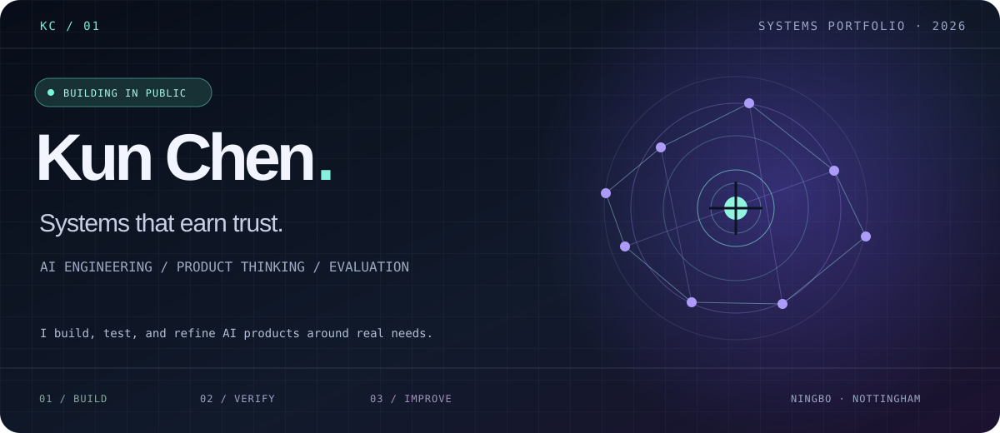
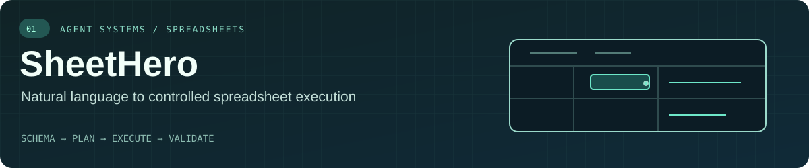
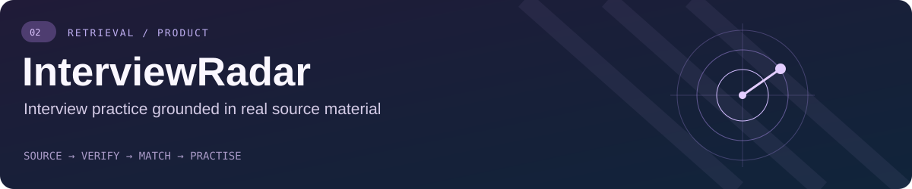
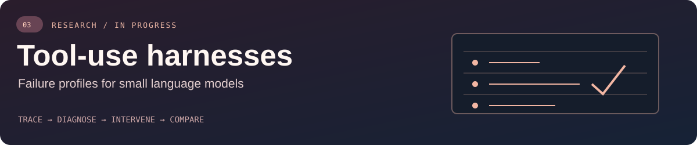

<div align="center">
  
</div>

<br />

<div align="center">
  <a href="https://kunchen1110.github.io/KunChen1110/">Personal homepage</a> &nbsp;·&nbsp;
  <a href="#selected-work">Selected work</a> &nbsp;·&nbsp;
  <a href="#how-i-build">How I build</a> &nbsp;·&nbsp;
  <a href="#beyond-ai">Beyond AI</a>
</div>

<br />

<table><tr><td width="72%" valign="top">

### Hello, I'm Kun 👋

I'm a Computer Science student at the **University of Nottingham Ningbo China**. I work where AI systems, software engineering and product decisions meet. The question that keeps me building: **how do we make a system useful when the model, the data and the tools can all fail?**

I take ideas from user need to working software, then use logs, evaluation and feedback to improve what actually happens.

</td><td width="28%" valign="top">

**CURRENT SIGNAL**

`AI systems`<br />
`Tool calling`<br />
`Retrieval + evaluation`<br />
`Product engineering`

📍 Ningbo / Nottingham

</td></tr></table>

## Selected work

<a href="https://github.com/KunChen1110/SheetHero"></a>

As **backend architecture lead** on this group project, I helped develop a spreadsheet agent with schema-aware planning, constrained execution and validation. The project grew through five major iterations; my [project write-up](https://github.com/KunChen1110/SheetHero) explains the workflow and its evaluation. `Python` `LangChain` `React` `Electron`

<br />

<a href="https://github.com/KunChen1110/InterviewRadar"></a>

I started with a problem I experienced myself: generic AI interview questions missed the details in my projects. The [open-source workflow](https://github.com/KunChen1110/InterviewRadar) retrieves public interview reports and keeps questions traceable to their sources. I later built a [web prototype](https://github.com/KunChen1110/InterviewRadar-Web) for staged practice, bounded follow-ups and feedback. `Python` `FastAPI` `PostgreSQL`

<br />



My final-year research examines **where small language models fail during multi-step tool use** and whether targeted runtime support helps. This is ongoing work, so I treat the diagram above as a research direction rather than a finished result.

## How I build

```text
real user need
    ↓
working prototype  →  observe failures  →  tighten the workflow
    ↑                                        ↓
    └──────────── evaluate and iterate ─────┘
```

I care about concrete boundaries: a model should know which tools it may call, where retrieved information came from, and how its output will be checked. My stack spans **Python, Java, C++, Swift, FastAPI, Spring Boot, SwiftUI, PostgreSQL and Docker**. I choose tools around the problem rather than around a badge list.

## Beyond AI

- **[Campus Asset Management](https://github.com/KunChen1110/CampusAssetManagement)** — Spring Boot backend with asset lifecycle rules, audit logs and controlled natural-language queries.
- **[BlastArena](https://github.com/KunChen1110/BlastArena)** — C++ / SDL2 arcade game with enemy behaviours, multiple modes and save support.

<br />

<div align="center">
  <sub>Build it. Trace what failed. Make the next version better.</sub>
</div>
