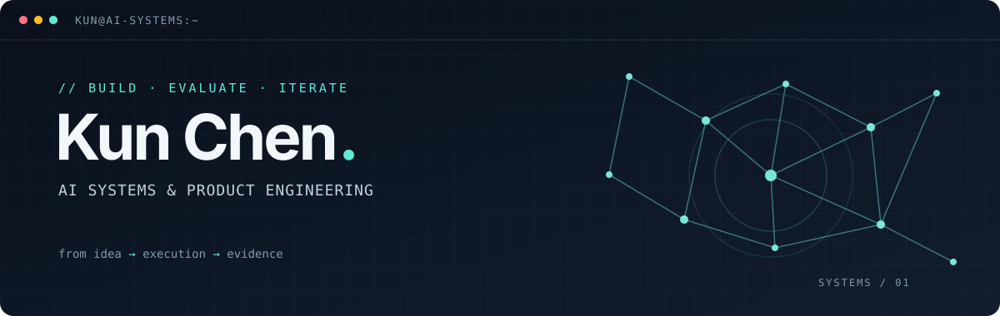

  

  <strong>AI systems · Product thinking · Full-stack engineering</strong> 
  Computer Science at the University of Nottingham Ningbo China

  <a href="#selected-work">Selected work</a> &nbsp; / &nbsp;
  <a href="#currently-exploring">Currently exploring</a> &nbsp; / &nbsp;
  <a href="#toolbox">Toolbox</a>

---

### `> hello, world`

I'm Kun, a computer science student interested in what happens **between a model's answer and a useful, reliable result**. I enjoy turning real problems into working products, and examining the retrieval, tools, validation and human decisions that make AI systems dependable.

My work moves between AI workflows, backend architecture and product design. I learn by building, measuring where things fail, and iterating on the system around the model.

### Selected work

**[SheetHero](https://github.com/KunChen1110/SheetHero)** &nbsp; `AI WORKFLOWS` `SPREADSHEETS`  
A natural-language interface for spreadsheet analysis. As backend architecture lead on the group project, I worked on staged agent workflows, schema-grounded execution and validation. The project explores how skill routing and controlled execution can make complex spreadsheet tasks more dependable.

**[InterviewRadar](https://github.com/KunChen1110/InterviewRadar)** &nbsp; `RETRIEVAL` `OPEN SOURCE`  
An interview-preparation workflow that connects public interview experiences with a candidate's résumé and target role. It emphasises source verification and traceable questions. Its companion **[Web prototype](https://github.com/KunChen1110/InterviewRadar-Web)** explores staged mock interviews, bounded follow-ups and feedback.

**[Campus Asset Management](https://github.com/KunChen1110/CampusAssetManagement)** &nbsp; `JAVA` `BACKEND`  
A Spring Boot backend for asset lifecycles, audit logs and statistics, with controlled natural-language queries built around whitelisted templates.

**[BlastArena](https://github.com/KunChen1110/BlastArena)** &nbsp; `C++` `GAME DEV`  
A Bomberman-inspired desktop game with grid-based gameplay, enemy behaviours and multiple modes, built with SDL2.

### Currently exploring

**Reliable tool calling for small language models.** My final-year dissertation investigates failure patterns in multi-step tool use and explores targeted runtime interventions. The experiments are ongoing.

### Toolbox

`Python` `Java` `C++` `Swift` &nbsp; · &nbsp; `FastAPI` `Spring Boot` `SwiftUI`  
`PostgreSQL` `MySQL` `Docker` &nbsp; · &nbsp; `LLM workflows` `retrieval` `evaluation`

---

Build thoughtfully. Observe failures. Keep iterating.

